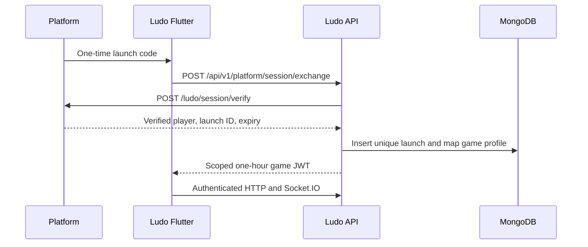
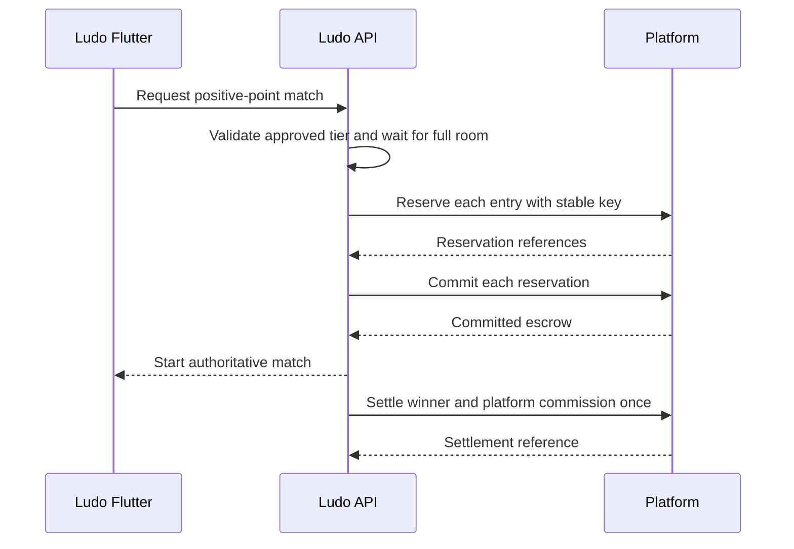

# Ludo Club integration guide

Ludo is a game module. The host platform owns player accounts, points, payment methods and financial policy. The Ludo backend owns game rules, match state, cosmetics and statistics. The real platform API has **not** been supplied. The adapter and local mock are implemented and tested; production connection and paid-match policy remain external dependencies.

## Local demonstration

1. Install Flutter, Node 20+, Android SDK and MongoDB with replica-set support. Install dependencies with `cd frontend && flutter pub get` and `cd backend && npm ci`.
2. Build Web with `cd frontend && flutter build web --release --dart-define=API_URL=http://127.0.0.1:3108 --no-wasm-dry-run`.
3. From the repository root run `bash scripts/dev-platform.sh`. It starts local MongoDB if needed, the mock platform on `127.0.0.1:3110`, the Ludo API on `127.0.0.1:3108`, and Web on `127.0.0.1:8080`.
4. Open `http://127.0.0.1:3110/`, select Ludo, play a free match, buy the Gold Dice using test points, and use **Return to platform**. The mock's starting balance and cosmetic prices are development fixtures only.

For the Android emulator demo, build `flutter build apk --debug --dart-define=API_URL=http://10.0.2.2:3108` and install it with `adb install -r build/app/outputs/flutter-apk/app-debug.apk`. With the local services running, execute `node scripts/launch-android-demo.mjs`; it obtains a fresh one-time code and sends it to `club.ludo.ludo_club/.MainActivity` as Android string extra `platform_session`. The native method channel consumes the extra and closes the activity for Return to platform. Do not share or reuse launch codes. An APK is a separate launchable package; it cannot be embedded directly in an unrelated app. An iOS host must implement the same method channel before release.

## Launch and identity

The host issues a short-lived one-time launch code. Web opens `#session=<encoded-code>`; the Web bridge removes the fragment from browser history immediately. Android uses method channel `ludo.club/platform`, method `getSession`. Flutter sends only the code to `POST /api/v1/platform/session/exchange`. Ludo validates it server to server through `POST {PLATFORM_API_URL}/ludo/session/verify` with `Authorization: Bearer <PLATFORM_API_KEY>`. Required verified response: `{playerId,launchId,tenantId,gameId,expiresAt,displayName,avatar}`. `gameId` must be `ludo-club`; launch expiry must be in the future and no more than five minutes away. The platform should consume the code once. Ludo inserts a unique launch ID, rejecting replay, maps the stable opaque player ID to a local game profile, and issues a one-hour game JWT bound to the launch. Both HTTP and Socket.IO check it. Web refresh reuses a still-valid game JWT; expiration requires a new launch. `POST /api/v1/game/session/end` revokes the launch and disconnects sockets. No player ID, balance, or role from Flutter is trusted.

The current profile key is `playerId`; the host must provide globally unique player IDs across tenants. If IDs are tenant-local, adapt the game profile mapping to a validated `(tenantId, playerId)` composite before connecting that host.



## Platform points adapter

Production requires `PLATFORM_MODE=true`, `PLATFORM_API_URL`, `PLATFORM_API_KEY`, `JWT_SECRET`, `MONGODB_URI` and `CORS_ORIGINS`. Production refuses a missing real platform adapter and refuses `PLATFORM_MOCK=true`. `PLATFORM_ADMIN_API_KEY` is a separate server-only game configuration credential. `PLATFORM_COSMETIC_PRICES_JSON` is an explicitly approved item-to-point-price map; omitted paid items remain unavailable. Legacy coin prices are never converted to points. All balances and prices are safe integers.

The outbound adapter sends server credentials to:

| Endpoint | Request | Response contract |
| --- | --- | --- |
| `POST /ludo/session/verify` | `{sessionToken}` | Verified launch data above; consume once |
| `POST /ludo/points/balance` | `{playerId}` | `{points: integer}` |
| `POST /ludo/points/purchase` | `{playerId,itemId,points,reference}` | `{approved:true,status:"COMMITTED",reference}` after atomic debit |
| `POST /ludo/points/transaction-status` | `{reference}` | Durable status, or 404 if unknown |
| `POST /ludo/points/reserve` | `{playerId,matchId,points,reference}` | `{reservationId,status:"RESERVED",reference}` |
| `POST /ludo/points/commit` | `{playerId,reservationId,matchId,reference}` | `{reservationId,status:"COMMITTED",reference}` |
| `POST /ludo/points/release` | `{playerId,reservationId,matchId,reference}` | `{reservationId,status:"RELEASED",reference}` |
| `POST /ludo/points/settle` | `{matchId,awards,commissionPoints,funding:"committed-entry-escrow",reference}` | `{status:"SETTLED",matchId,reference}` |

Every point-changing call includes `Idempotency-Key: <reference>`. The platform must process concurrent calls atomically, reject negative balances, return the same committed result for retries, and allow status lookup after ambiguous timeouts. The loopback-only mock implements balances, reserve/commit/release/settle, purchases, transaction status, admin credit, failure injection, and one-time launch codes. It cannot run in production and does not represent real funds.

### Cosmetic purchase and recovery

Flutter sends an item ID and UUID request ID, never a price. The server validates its catalog, approved point price, availability, authenticated player, and ownership. `CosmeticPurchase` is persisted as `PENDING` before calling the platform with reference `ludo:cosmetic:<playerId>:<requestId>`. Only a confirmed debit grants ownership and marks `COMMITTED`; a decline marks `DECLINED`. On timeout Ludo queries transaction status, returning HTTP 202 if still unresolved. Retrying the same request ID or calling `GET /api/shop/purchases/:requestId/status` reconciles it. Equip requires durable ownership. The integration test covers duplicate purchase, price tampering, failure injection, pending recovery and equip.

```mermaid
sequenceDiagram
  participant UI as Ludo Flutter
  participant API as Ludo API
  participant Host as Platform
  UI->>API: Buy item ID + UUID
  API->>API: Validate; persist PENDING
  API->>Host: Purchase (Idempotency-Key)
  alt Confirmed
    Host-->>API: COMMITTED
    API->>API: Grant ownership
    API-->>UI: Updated inventory
  else Timeout
    API->>Host: Query transaction status
    API-->>UI: 202 PENDING if unresolved
    UI->>API: Retry same UUID or query status
  end
```

### Paid match funding and approval

Positive-point Classic matches now use persistent `Game.platformFinance` transitions and the server-to-server adapter. A versioned policy must be configured in `PLATFORM_MATCH_POLICY_JSON` and the tier enabled by platform admin. Production rejects test-only policies. The host must approve actual points, winner award, commission, forfeit/timeout and cancellation semantics. The isolated test policy is documented in `integration/PLATFORM_DEVELOPER_START_HERE.md`; it is not commercial authorization. The local mock enforces committed-entry escrow conservation and idempotency. The real platform has not been connected or contract-tested. No EGP conversion is assumed.



## Hosting, administration and security

Flutter Web is a static top-level game launch. Use `--base-href=/your/path/` for path hosting and set `API_URL` at build time to the Ludo HTTPS origin. `CORS_ORIGINS` must list exact Web origins; Socket.IO uses WebSocket transport. A production CSP should allow only approved HTTPS/WSS endpoints and an approved `frame-ancestors` if iframe hosting is explicitly required. The local static server is development-only. `GET/PUT /api/v1/platform/admin/config` uses `PLATFORM_ADMIN_API_KEY`, validates updates, and writes an audit record. It controls enable/maintenance, Classic/Practice availability, displayed tiers and cosmetic availability, not payments or payouts. Magic and Fast remain unavailable pending rules. Legacy EGP/Vodafone collections and code are retained for migration but unreachable by platform player sessions in `PLATFORM_MODE=true`.

## Verification and external dependencies

Run `cd backend && npm test`, `TEST_MONGODB_URI=mongodb://127.0.0.1:27028/ludo_test?replicaSet=ludo npm run test:integration`, and `TEST_MONGODB_URI=mongodb://127.0.0.1:27028/ludo_test_platform?replicaSet=ludo npm run test:platform`. These suites drop only explicitly isolated test databases. Run `cd frontend && flutter analyze && flutter test`, then the Android and Web build commands above. The actual platform team must supply session verification/key rotation, HTTPS endpoints, status semantics, approved cosmetic prices, payout/refund/commission rules, atomic match funding, service credential rotation, Web origin/base path, Android host ownership and an iOS bridge if used. See `integration/openapi.yaml`, `integration/AUDIT.md`, and `photos/ASSET_INVENTORY.md`.
